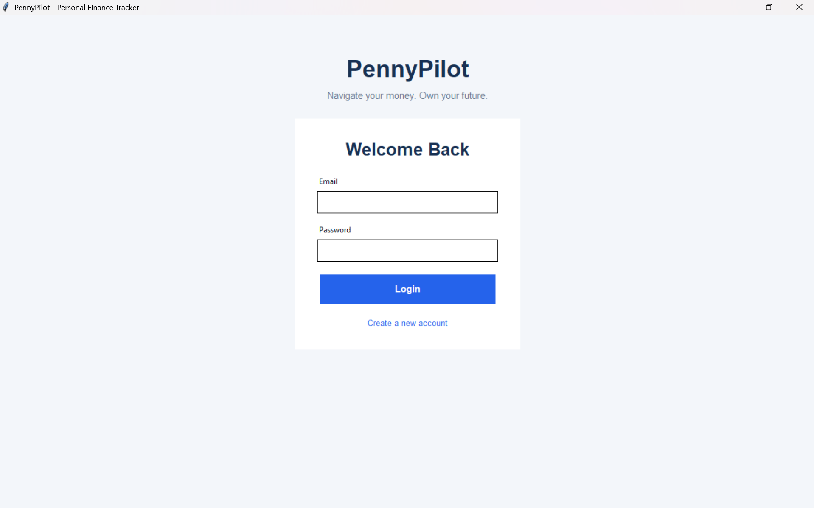
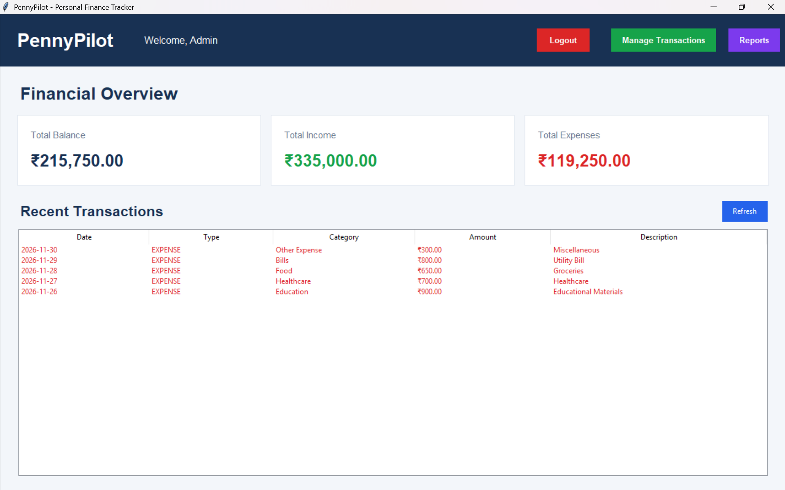
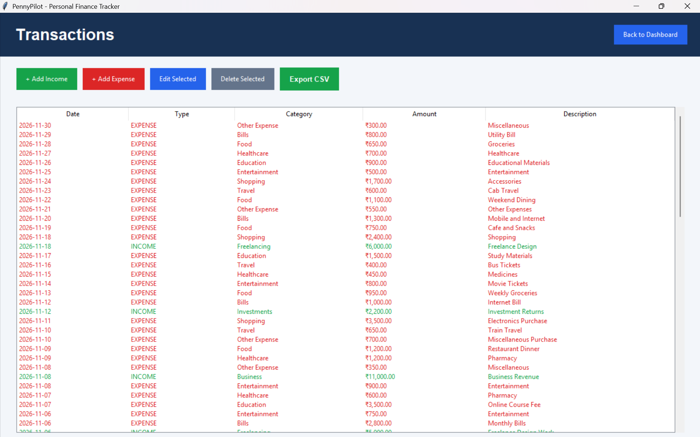
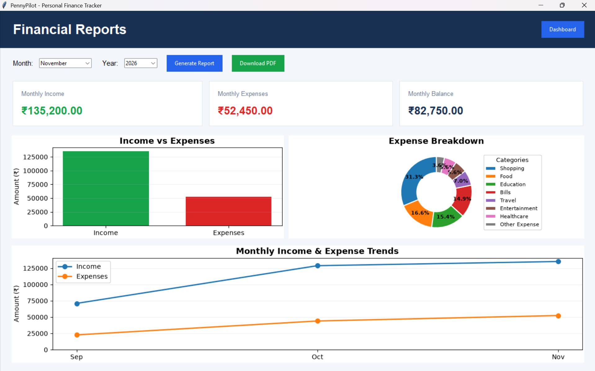

# PennyPilot 💰

**A Personal Finance Tracker built with Python, Tkinter, and MySQL.**

PennyPilot is a desktop-based personal finance management application that helps users track their income and expenses, monitor their financial activity, and generate detailed financial reports.

The application provides a simple graphical interface for managing transactions and visualizing spending patterns.

## ✨ Features

- **User Authentication:** Secure registration and login with password hashing.
- **Dashboard:** View total income, expenses, balance, and recent transactions.
- **Transaction Management:** Add, edit, view, and delete income and expense transactions.
- **Category Management:** Organize transactions using predefined income and expense categories.
- **Financial Analytics:** View monthly income, expenses, and balance.
- **Data Visualization:** Interactive charts for income, expenses, spending breakdown, and monthly trends.
- **CSV Export:** Export transaction history into CSV files.
- **PDF Reports:** Generate downloadable monthly financial reports.
- **Database Integration:** Store user accounts, transactions, and categories using MySQL.

## 🛠️ Technologies Used

| Technology | Purpose |
|---|---|
| Python | Application logic |
| Tkinter | Graphical user interface |
| MySQL | Database management |
| mysql-connector-python | Python-MySQL connectivity |
| Matplotlib | Financial charts and visualizations |
| bcrypt | Password hashing |
| python-dotenv | Environment configuration |
| ReportLab | PDF report generation |

## 📁 Project Structure

```text
PennyPilot/
│
├── main.py
│
├── backend/
│   ├── auth.py
│   ├── transaction.py
│   ├── analytics.py
│   └── pdf_export.py
│
├── frontend/
│   ├── login.py
│   ├── register.py
│   ├── dashboard.py
│   ├── transactions.py
│   └── reports.py
│
├── database/
│   ├── connection.py
│   ├── setup.sql
│   └── test_connection.py
│
├── config/
│
├── assets/
│   ├── images/
│   └── icons/
│
├── requirements.txt
├── .gitignore
└── README.md
```

## ⚙️ Installation and Setup

### 1. Clone the Repository

```bash
git clone https://github.com/Collins-Ce/pennypilot.git
cd pennypilot
```

### 2. Create a Virtual Environment

```bash
python -m venv .venv
```

Activate it on Windows PowerShell:

```powershell
.\.venv\Scripts\Activate.ps1
```

### 3. Install Dependencies

```bash
pip install -r requirements.txt
```

### 4. Configure MySQL

Make sure MySQL Server is installed and running.

Create the project database and tables by executing:

```bash
mysql -u root -p < database/setup.sql
```

If you use MySQL Workbench or MySQL Shell, you can also execute the SQL statements from `database/setup.sql` there.

### 5. Configure Environment Variables

Create a `.env` file in the project's root directory.

Add your own MySQL credentials:

```env
DB_HOST=localhost
DB_USER=root
DB_PASSWORD=your_mysql_password
DB_NAME=pennypilot_db
DB_PORT=3306
```

**Important:** Never commit your `.env` file or expose your database password publicly.

### 6. Test the Database Connection

```bash
python -m database.test_connection
```

### 7. Run PennyPilot

```bash
python main.py
```

## 📸 Application Screenshots

### Login

Secure user login interface.



### Dashboard

Overview of income, expenses, balance, and recent transactions.



### Transaction Management

Manage income and expenses with category-based transaction records.



### Financial Reports

Visualize spending patterns, monthly trends, and financial summaries.



## 📊 Application Modules

- **Dashboard:** Financial overview and recent transactions.
- **Transaction Management:** Add, edit, delete, and export transactions.
- **Financial Analytics:** Monthly summaries and visual charts.
- **CSV Export:** Download transaction history.
- **PDF Reports:** Generate monthly financial reports.

## 🔐 Security

- Passwords are hashed using bcrypt.
- Database credentials are stored in environment variables.
- Transactions are associated with individual user accounts.
- Database queries use parameterized statements.

## 🚀 Future Improvements

Potential future enhancements include:

- Budget creation and tracking.
- Monthly spending limits.
- Savings goals.
- Recurring transactions.
- More advanced financial insights.

## 👨‍💻 Author

**Collins Cecil**

GitHub: [@Collins-Ce](https://github.com/Collins-Ce)

---

*PennyPilot: Take control of your money, one transaction at a time.*